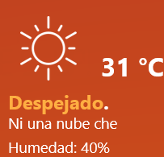

# CheClimatico para Rainmeter
Un fork de Shanee's AuthenticWeather que se corrigió para que funcione con la nueva API meteorológica, se dejan de utilizar las frases NSFW y se "argentinizó".

(fondo transparente)

## Instalación:

- Descargá el archivo zip desde [Releases](https://github.com/masterofobzene/CheClimatico-Rainmeter/releases).
- Navegá a tu carpeta de skins de Rainmeter.
- **Descomprimílo allí junto con las otras skins.**
- Editá el archivo `CheClimatico.ini` y agregá tu API de OpenWeatherMap, Latitud y Longitud.
- Actualizá el skin.
- __SI LOS ACENTOS NO SE MUESTRAN DEBES GRABAR LOS .lua Y EL .ini EN FORMATO UTF-16LE CON NOTEPAD++.__

### Aclaraciones

OpenWeatherMap suele no pegarle mucho con el clima por estas zonas (porque no usa ninguna medición con equipos
sino que triangula datos y hace predicciones... bla bla bla).
Te cuento esto, porque más de una vez vas a ver "Despejado" cuando el mundo está por venirse abajo. No es la
app, es el servicio que utiliza ☂.
